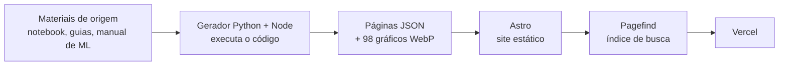

# Manual de Análise de Dados

**Guia de referência em português para quem recebe um dataset e precisa ir da importação ao relatório, com código executado de verdade, gráficos reais e um manual de decisão de Machine Learning.**

**[Abrir o site](https://manual-analise-de-dados.vercel.app)** · [Decisões técnicas](docs/DECISOES.md) · [Arquitetura da informação](docs/ARQUITETURA.md) · [Limites conhecidos](docs/OBSERVACOES.md)


## O problema

Quem trabalha com dados em português costuma achar o material espalhado: um tutorial de pandas aqui, um guia de gráficos ali, um template de relatório em outro lugar. Quase sempre o código aparece sem a saída real, e nada ajuda a decidir qual modelo usar. Na prática, cada projeto novo começa reconstruindo a mesma base.

Este projeto junta quatro materiais que escrevi numa **trilha única**, que segue a ordem real de um projeto: *importar → conhecer → limpar → descrever → explorar → testar → modelar → comunicar*. Cada trecho de código pode ser copiado e reaproveitado sem retrabalho.

## O que o site entrega

| Material | Conteúdo |
|---|---|
| **Notebook mestre de análise de dados** | a espinha dorsal da trilha: importação (arquivos e SQL), limpeza, estatística descritiva, análise uni/bi/multivariada, testes de hipótese e checklist final, com as saídas e os gráficos da execução real |
| **Guia matplotlib e seaborn** | fundamentos, catálogo de 16 gráficos, antes e depois, storytelling com dados e erros comuns |
| **Guia do relatório profissional** | do pedido à entrega: briefing, listas de verificação, modelos de texto e um modelo de relatório em `.docx` |
| **Manual de Machine Learning** | 43 modelos em cartões de 20 blocos, árvore e matriz de decisão, validação, uma skill de decisão e a auditoria técnica |
| **Diagnóstico de dataset no navegador** | você carrega um CSV, XLSX ou JSON e recebe um diagnóstico e um código inicial; o arquivo **não sai do seu computador** |
| **10 notebooks modelo de ML** | templates genéricos (regressão, árvore, K-Means, anomalias, redes neurais, recomendação, DQN) com uma única célula de configuração, para baixar e adaptar |

## Evidências (verificáveis neste repositório)

| O que | Resultado | Onde conferir |
|---|---|---|
| Fidelidade ao conteúdo de origem | **10.292 de 10.292** trechos de texto e código presentes no site, 0 ausentes | [`docs/qualidade/verificacao-conteudo.json`](docs/qualidade/verificacao-conteudo.json) |
| Código executado | **289 blocos** de código e **98 gráficos** gerados pela execução, sem erros | [`site/gerador/`](site/gerador/) |
| Acessibilidade (WCAG 2.2 AA) | axe-core em **67 páginas × 2 temas**: 0 violações; 21 de 21 passos de navegação por teclado | [`docs/qualidade/acessibilidade-axe.json`](docs/qualidade/acessibilidade-axe.json) |
| Desempenho e qualidade | Lighthouse em 9 páginas, celular e desktop: desempenho **98 a 99**; acessibilidade, boas práticas e SEO **100** | [`docs/qualidade/lighthouse/RESUMO.md`](docs/qualidade/lighthouse/RESUMO.md) |
| Notebooks modelo | 10 templates validados de ponta a ponta em **30 cenários** de dados diferentes, mais 3 treinos completos do DQN | [`docs/NOTEBOOKS-MODELO.md`](docs/NOTEBOOKS-MODELO.md) |
| Consistência visual | build falha se aparecer qualquer cor, fonte ou espaçamento fora dos tokens do design system | [`site/scripts/verificar-tokens.mjs`](site/scripts/verificar-tokens.mjs) |

A revisão dos notebooks de ML é a parte com mais critério técnico do projeto. Ela registra problemas nos notebooks de estudo originais e como foram corrigidos: **vazamento de dados** no recomendador (escalonadores ajustados antes da divisão), **avaliação feita no próprio treino**, softmax numericamente instável, gradiente descendente que não convergia e uma API de ambiente descontinuada.

## Decisões técnicas

| Decisão | Por quê |
|---|---|
| **Astro** em modo estático, sem framework de interface no navegador | HTML puro e rápido; só o JavaScript de cada página é enviado. Starlight e Docusaurus foram descartados porque trazem CSS próprio, o que violaria a regra de "nenhum valor fora dos tokens" |
| **Pagefind** para a busca | índice estático gerado no build, carregado sob demanda, com radical da língua portuguesa e destaque do termo na página de destino. Não precisa de servidor |
| **Gerador em Python** (com um extrator em Node) | os materiais são notebooks, scripts e HTML. O gerador executa o código de verdade e grava as páginas em JSON, sem reescrever o conteúdo; o código exibido é sempre o original |
| **Conteúdo gerado versionado** | `npm run build` não depende de Python nem de rede, o que deixa o deploy na Vercel simples e reprodutível |
| **Diagnóstico 100 % no navegador** | privacidade: o dataset do usuário nunca é enviado a um servidor |

Registro completo, com alternativas descartadas: [`docs/DECISOES.md`](docs/DECISOES.md).

## Como funciona



## Estrutura do repositório

```
manual-analise-de-dados/
├── site/                  site Astro (pasta publicada na Vercel)
│   ├── src/               páginas, layout, componentes, estilos e conteúdo gerado
│   ├── public/            gráficos, fontes e downloads (.ipynb, .docx, .md)
│   ├── gerador/           gerador Python/Node e os materiais de origem
│   ├── scripts/           verificação de tokens, acessibilidade, Lighthouse e capturas
│   └── design-system/     especificação do design system
└── docs/                  decisões, arquitetura, design system, inventário,
                           observações, revisão dos notebooks e resultados das auditorias
```

## Rodar localmente

Requisito: Node 20 ou mais recente (testado com o 24).

```bash
cd site
npm ci
npm run build
npm run preview
```

O site abre em `http://localhost:4321`. Para regenerar o conteúdo a partir dos materiais de origem (exige Python) e rodar as auditorias, veja [`site/README.md`](site/README.md).

## Limites conhecidos

Declarados de propósito, com detalhes em [`docs/OBSERVACOES.md`](docs/OBSERVACOES.md):

- O site reproduz os materiais **como estão**: os erros e as duplicações encontrados foram registrados, não corrigidos no conteúdo. A consolidação dos trechos repetidos ainda não foi feita.
- Os scripts da auditoria do manual de ML não foram reexecutados na montagem do site; os números da auditoria são os declarados nela.
- O diagnóstico de dataset foi testado com CSV; ainda falta testar com arquivos XLSX e JSON reais.
- Cinco trechos do guia de visualização atribuídos a referências externas estão marcados como "a confirmar".

## Licença

- **Código** (site, gerador, scripts e todo bloco de código dos materiais): [MIT](LICENSE).
- **Conteúdo** (textos, gráficos, guias, modelo de relatório e documentação): [CC BY 4.0](LICENSE-CONTEUDO.md).
- Exceções de terceiros (fontes e origem dos notebooks modelo) estão em [`LICENSE-CONTEUDO.md`](LICENSE-CONTEUDO.md).

## Autor

**Fernando Figueiredo**, autor dos quatro materiais e do site.
