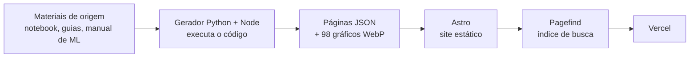

# Manual de Análise de Dados

**Guia de referência em português para quem recebe um dataset e precisa ir da importação ao relatório. Todo o código é executado na geração do site e um manual ajuda a decidir qual modelo de Machine Learning usar.**

**[Abrir o site](https://manual-analise-de-dados.vercel.app)** · [Notebooks](#notebooks) · [Decisões técnicas](docs/DECISOES.md) · [Limites conhecidos](#limites-conhecidos)


## O problema

Quem trabalha com dados em português costuma achar o material espalhado: um tutorial de pandas aqui, um guia de gráficos ali, um template de relatório em outro lugar. Quase sempre o código aparece sem a saída, e nada ajuda a decidir qual modelo usar. Na prática, cada projeto novo começa reconstruindo a mesma base.

Este projeto junta quatro materiais que escrevi numa **trilha única**, que segue a ordem real de um projeto: *importar → conhecer → limpar → descrever → explorar → testar → modelar → comunicar*. Cada trecho de código pode ser copiado e reaproveitado sem retrabalho.

## O que este projeto demonstra

| Competência | Evidência | Onde ver |
|---|---|---|
| **Diagnosticar falhas em modelos de ML** | revisão de 10 notebooks de estudo com **59 problemas registrados e corrigidos**, entre eles vazamento de dados (escalonadores e médias calculados antes da divisão treino/teste), avaliação feita no próprio treino, softmax numericamente instável e gradiente descendente que não convergia | [`docs/NOTEBOOKS-MODELO.md`](docs/NOTEBOOKS-MODELO.md) |
| **Desenhar validação de modelos** | divisão treino/validação/teste, pré-processamento ajustado só no treino, métricas adequadas ao tipo de problema e comparação com a implementação de referência (scikit-learn ou Keras), em 10 templates validados em **30 cenários** de dados | [Notebooks](#notebooks) |
| **Estatística inferencial** | escolha do teste e verificação de pressupostos, testes para dois ou mais grupos, proporções e testes A/B, tamanho de efeito | [Inferir](https://manual-analise-de-dados.vercel.app/inferir/conceitos-e-pressupostos/) |
| **Métricas de negócio** | KPIs gerais e por segmento, funil, coortes e curva de retenção | [Métricas de negócio](https://manual-analise-de-dados.vercel.app/explorar/metricas-de-negocio/) |
| **Comunicar resultados** | do pedido à entrega: briefing, estrutura do relatório, storytelling com dados e um modelo de relatório em `.docx` | [Comunicar](https://manual-analise-de-dados.vercel.app/comunicar/estruturar-o-relatorio/) |
| **Pipeline reprodutível** | gerador que executa os notebooks e o código dos guias e grava as páginas, com verificação automática de que **10.292 de 10.292** trechos de origem estão no site | [`site/gerador/`](site/gerador/) |

## Notebooks

Os notebooks rodam do início ao fim sem configuração, com **dados sintéticos de exemplo**. Para usar com um dataset próprio, basta preencher a única célula de configuração (caminho do arquivo, coluna-alvo e features).

| Notebook | O que faz | Resultado na validação |
|---|---|---|
| [Notebook mestre de análise de dados](site/gerador/origem/Notebook_Mestre_Analise_de_Dados.ipynb) | a trilha completa: importação (arquivos e SQL), limpeza, estatística descritiva, análise exploratória, outliers, análise temporal, métricas de negócio, testes de hipótese e checklist | executado inteiro sem erros na geração do site; as saídas e os 98 gráficos estão nas páginas |
| [Regressão linear](site/gerador/origem/modelos-ml/modelo_ml_regressao_linear.ipynb) | gradiente descendente vetorizado para *n* features, com MAE, RMSE, R² e análise de resíduos | coincide com `LinearRegression`; acusa quando o gradiente descendente não chegou ao ótimo |
| [Regressão logística](site/gerador/origem/modelos-ml/modelo_ml_regressao_logistica.ipynb) | sigmoide e log loss com regularização L2, ROC-AUC, PR-AUC, F1 e escolha do limiar | coeficientes iguais aos do scikit-learn (diferença ≤ 0,001) |
| [Rede neural binária](site/gerador/origem/modelos-ml/modelo_ml_rede_neural_binaria.ipynb) | MLP em NumPy e em Keras 3, com early stopping | ROC-AUC 0,97; NumPy e Keras com diferença de ~1e-7 |
| [Rede neural multiclasse](site/gerador/origem/modelos-ml/modelo_ml_rede_neural_multiclasse.ipynb) | softmax numericamente estável, rótulos de texto, matriz de confusão | acurácia 0,93 nos dígitos de 0 a 9 |
| [Regressão polinomial: viés × variância](site/gerador/origem/modelos-ml/modelo_ml_regressao_polinomial_vies_variancia.ipynb) | escolha de grau e λ na validação, com o teste usado uma única vez | reproduz o sobreajuste do modelo complexo |
| [Árvore de decisão](site/gerador/origem/modelos-ml/modelo_ml_arvore_de_decisao.ipynb) | implementação do zero com entropia ou Gini, features numéricas e regras SE…ENTÃO | acurácia próxima à do scikit-learn |
| [Detecção de anomalias gaussiana](site/gerador/origem/modelos-ml/modelo_ml_deteccao_anomalias_gaussiana.ipynb) | densidade em log (sem underflow), limiar escolhido na validação e avaliado no teste | F1 de teste 1,0 nos três cenários rotulados; equivale ao `GaussianMixture` |
| [K-Means](site/gerador/origem/modelos-ml/modelo_ml_kmeans.ipynb) | k-means++, várias inicializações, cotovelo e silhouette, compressão de imagem | índice de Rand ajustado 1,0; inércia igual à do scikit-learn |
| [Recomendação por conteúdo](site/gerador/origem/modelos-ml/modelo_ml_recomendacao_conteudo_rede_neural.ipynb) | rede de duas torres, sem vazamento, com precision@k, recall@k e NDCG@k | NDCG@10 de 0,054 contra 0,020 da recomendação por popularidade |
| [Deep Q-Network](site/gerador/origem/modelos-ml/modelo_ml_dqn.ipynb) | DQN com replay e rede-alvo em Gymnasium, checkpoint dos melhores pesos | retorno 500 (o máximo) no CartPole com 3 sementes |

Os 10 notebooks de ML foram reescritos a partir de exercícios de um curso, com a origem indicada no cabeçalho de cada um. Os detalhes estão em [`docs/NOTEBOOKS-MODELO.md`](docs/NOTEBOOKS-MODELO.md).

## O que o site entrega

| Material | Conteúdo |
|---|---|
| **Notebook mestre de análise de dados** | a espinha dorsal da trilha, com o código e as saídas da execução |
| **Guia matplotlib e seaborn** | fundamentos, catálogo de 16 gráficos, antes e depois, storytelling com dados e erros comuns |
| **Guia do relatório profissional** | briefing, listas de verificação, modelos de texto e modelo de relatório em `.docx` |
| **Manual de Machine Learning** | 43 modelos em cartões de 20 blocos, árvore e matriz de decisão, validação, skill de decisão e auditoria técnica |
| **Diagnóstico de dataset no navegador** | lê um CSV, XLSX ou JSON e devolve um diagnóstico e um código inicial; o arquivo **não sai do computador** de quem usa |

## Qualidade do site

- **Fidelidade:** 10.292 de 10.292 trechos de texto e código dos materiais estão no site, nenhum ausente ([`verificacao-conteudo.json`](docs/qualidade/verificacao-conteudo.json)).
- **Acessibilidade (WCAG 2.2 AA):** axe-core em 67 páginas e nos dois temas, 0 violações; 21 de 21 passos de navegação por teclado ([`acessibilidade-axe.json`](docs/qualidade/acessibilidade-axe.json)).
- **Lighthouse** em 9 páginas, celular e desktop: desempenho de 98 a 99; acessibilidade, boas práticas e SEO 100 ([`RESUMO.md`](docs/qualidade/lighthouse/RESUMO.md)).
- **Consistência visual:** o build falha se aparecer qualquer cor, fonte ou espaçamento fora dos tokens do design system ([`verificar-tokens.mjs`](site/scripts/verificar-tokens.mjs)).

## Decisões técnicas

| Decisão | Por quê |
|---|---|
| **Astro** em modo estático, sem framework de interface no navegador | HTML puro e rápido; só o JavaScript de cada página é enviado. Starlight e Docusaurus foram descartados porque trazem CSS próprio, o que violaria a regra de "nenhum valor fora dos tokens" |
| **Pagefind** para a busca | índice estático gerado no build, carregado sob demanda, com radical da língua portuguesa e destaque do termo na página de destino. Não precisa de servidor |
| **Gerador em Python** (com um extrator em Node) | os materiais são notebooks, scripts e HTML. O gerador executa o código e grava as páginas em JSON, sem reescrever o conteúdo; o código exibido é sempre o original |
| **Conteúdo gerado versionado** | `npm run build` não depende de Python nem de rede, o que deixa o deploy na Vercel simples e reprodutível |
| **Diagnóstico 100 % no navegador** | privacidade: o dataset de quem usa nunca é enviado a um servidor |

Registro completo, com alternativas descartadas: [`docs/DECISOES.md`](docs/DECISOES.md).

## Como funciona



## Como este projeto foi feito

Os quatro materiais de origem e o design system são de minha autoria. O site, o gerador, as auditorias e a revisão dos notebooks de ML foram construídos com o **Claude Code** (assistente de programação da Anthropic), sob a minha direção. Por isso o Claude aparece como co-autor nos commits.

As decisões foram minhas:

- o recorte: reunir os quatro materiais numa trilha única, com o notebook mestre como espinha dorsal;
- a regra de preservar o conteúdo dos materiais sem perda, que a verificação automática de 10.292 trechos garante;
- o design system e a exigência de que nenhum valor visual fique fora dos tokens;
- as mudanças de escopo no meio do projeto: incluir o manual de Machine Learning, trocar o design system e regenerar os gráficos no tema escuro;
- o que fica fora do repositório público: os exercícios originais do curso, que não pertencem a mim.

Tudo o que entrou passou pelas verificações descritas em [Qualidade do site](#qualidade-do-site), e os limites estão declarados logo abaixo.

## Limites conhecidos

Declarados de propósito, com detalhes em [`docs/OBSERVACOES.md`](docs/OBSERVACOES.md):

- **Os dados são sintéticos.** O notebook mestre e os templates de ML rodam sobre dados de exemplo gerados por código. Ainda não há um estudo de caso com dataset real.
- O site reproduz os materiais **como estão**: os erros e as duplicações encontrados foram registrados, não corrigidos no conteúdo. A consolidação dos trechos repetidos ainda não foi feita.
- Os scripts da auditoria do manual de ML não foram reexecutados na montagem do site; os números da auditoria são os declarados nela.
- O diagnóstico de dataset foi testado com CSV; ainda falta testar com arquivos XLSX e JSON reais.
- Cinco trechos do guia de visualização atribuídos a referências externas estão marcados como "a confirmar".

## Estrutura do repositório

```
manual-analise-de-dados/
├── site/                  site Astro (pasta publicada na Vercel)
│   ├── src/               páginas, layout, componentes, estilos e conteúdo gerado
│   ├── public/            gráficos, fontes e downloads (.ipynb, .docx, .md)
│   ├── gerador/           gerador Python/Node
│   │   └── origem/        materiais de origem: notebook mestre, guias e modelos-ml/
│   ├── scripts/           verificação de tokens, acessibilidade, Lighthouse e capturas
│   └── design-system/     especificação do design system
└── docs/                  decisões, arquitetura, design system, inventário,
                           observações, revisão dos notebooks e resultados das auditorias
```

## Rodar localmente

Requisito: Node 20 ou mais recente (testado com o 24).

```bash
cd site
npm ci
npm run build
npm run preview
```

O site abre em `http://localhost:4321`. Para regenerar o conteúdo a partir dos materiais de origem (exige Python) e rodar as auditorias, veja [`site/README.md`](site/README.md).

## Licença

- **Código** (site, gerador, scripts e todo bloco de código dos materiais): [MIT](LICENSE).
- **Conteúdo** (textos, gráficos, guias, modelo de relatório e documentação): [CC BY 4.0](LICENSE-CONTEUDO.md).
- Exceções de terceiros (fontes e origem dos notebooks modelo) estão em [`LICENSE-CONTEUDO.md`](LICENSE-CONTEUDO.md).

## Autor

**Fernando Figueiredo**, autor dos quatro materiais e do site.
